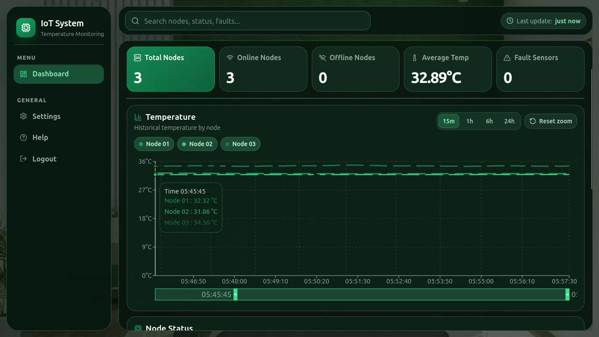
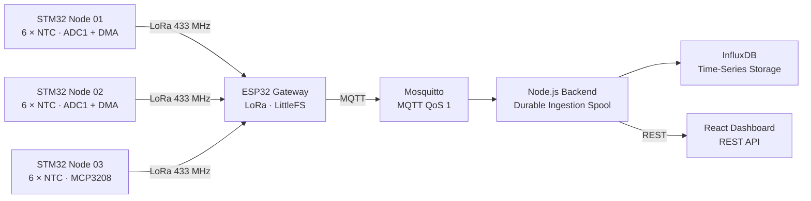
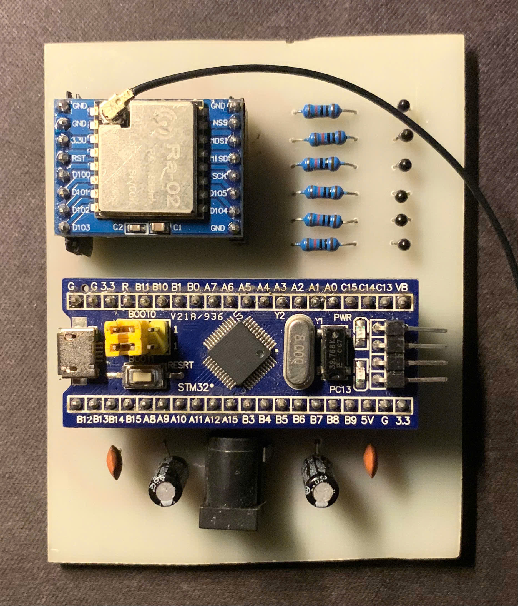
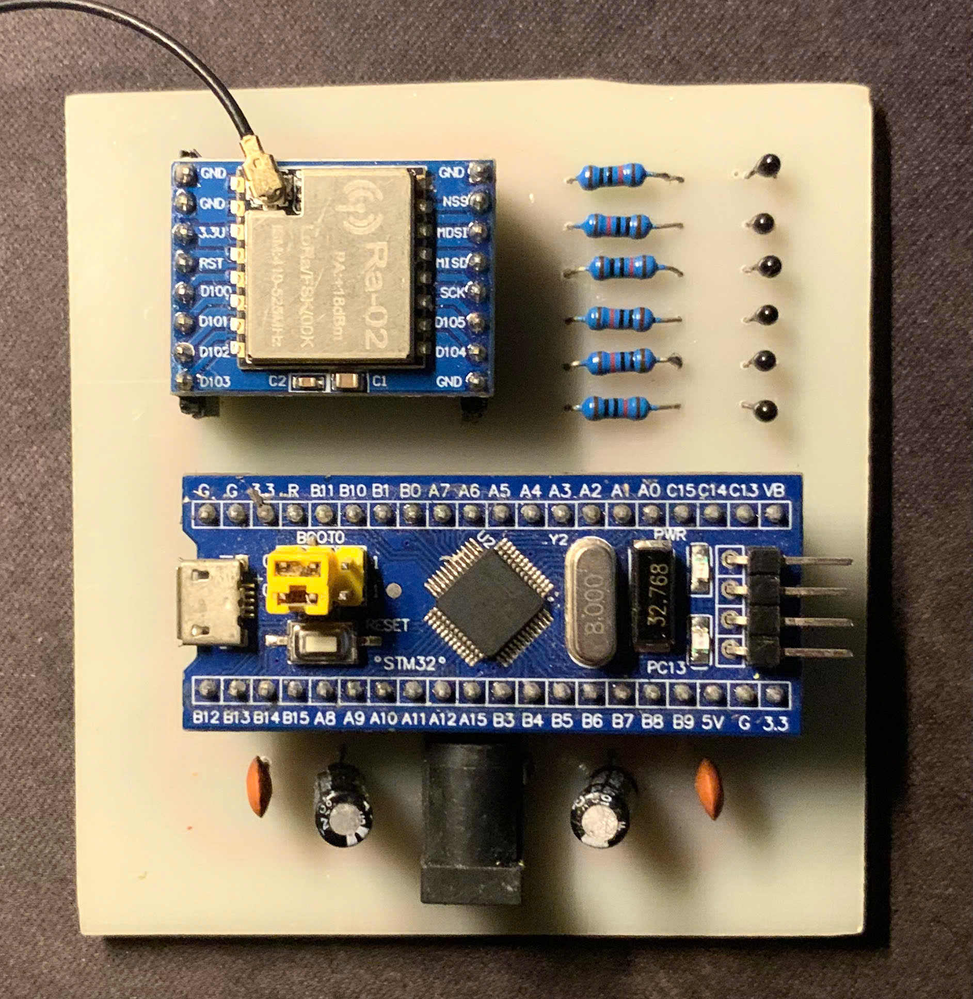
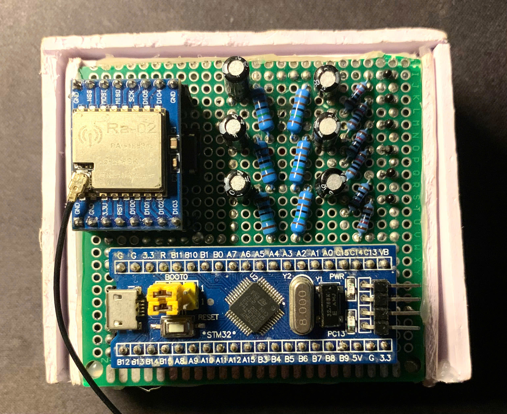
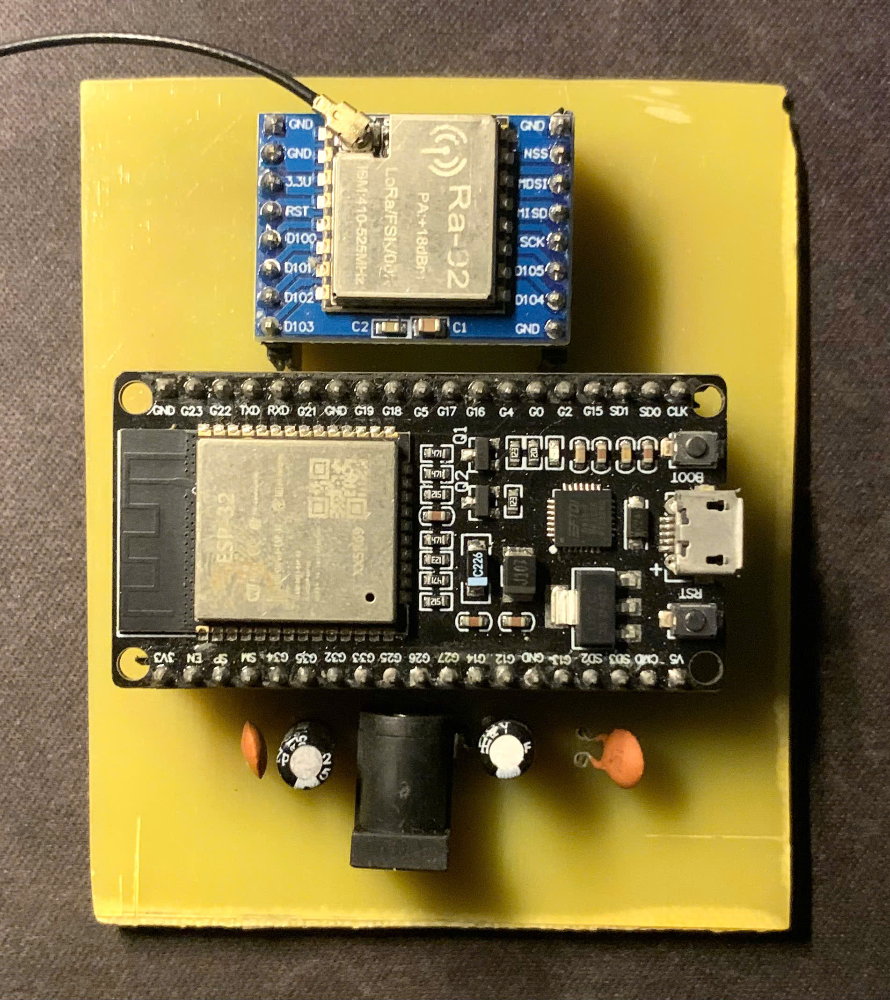

# IoT System

An end-to-end embedded IoT temperature-monitoring system built with **STM32**, **ESP32**, **LoRa**, **MQTT**, **Node.js**, **InfluxDB**, and **React**.

The project focuses on one problem beyond basic telemetry: **preserving sensor data across real failure boundaries**. Measurements can survive LoRa retries, Wi-Fi or MQTT outages, gateway reboots, broker restarts, backend interruption, and temporary InfluxDB unavailability through layered acknowledgement and durable buffering.

<p align="center">
  <a href="https://github.com/haikevins/iot-system/actions/workflows/ci.yml"></a>
  
  
  <a href="LICENSE"></a>
</p>

<p align="center">
  
</p>

<p align="center">
  <a href="#system-architecture">Architecture</a> ·
  <a href="#reliability-design">Reliability</a> ·
  <a href="#quick-start">Quick start</a> ·
  <a href="#documentation">Documentation</a> ·
  <a href="#demo">Demo</a>
</p>

---

## What This Project Demonstrates

- **Embedded acquisition:** three STM32F103 sensor nodes acquire and validate six NTC temperature channels each.
- **Custom radio transport:** SX1278 LoRa links use a compact application protocol with CRC, sequence numbers, retry, acknowledgement, and duplicate detection.
- **Offline-first gateway design:** the ESP32 gateway persists telemetry to LittleFS before acknowledging a node and retains records until MQTT QoS 1 completion.
- **Durable server ingestion:** Mosquitto persistence and a filesystem-backed Node.js ingestion spool protect data before it is committed to InfluxDB.
- **Operational visibility:** the React dashboard exposes current temperature, history, RSSI, freshness, online/offline state, and per-sensor diagnostics.

## System Architecture



The system is intentionally split into independently documented layers so that sensing, transport, persistence, storage, and presentation can be reasoned about separately.

## Reliability Design

The central design rule is **do not acknowledge data before the next layer has made it durable enough to recover**.

| Boundary | Mechanism | Failure handled |
|---|---|---|
| STM32 → ESP32 | DATA/ACK transaction, sequence number, retry, duplicate detection | Packet loss and ACK loss |
| ESP32 flash | Persist to LittleFS before node ACK | Wi-Fi/MQTT outage and gateway reboot |
| ESP32 → Mosquitto | MQTT QoS 1; remove queued record after PUBACK | Temporary broker/network interruption |
| Mosquitto | Authentication, persistent sessions, disk persistence | Broker restart and subscriber interruption |
| Mosquitto → Backend | Durable filesystem spool before MQTT acknowledgement | Backend crash after message delivery |
| Backend → InfluxDB | Pending/done/rejected spool and replay | Temporary database outage or poison record |

This chain is the main architectural feature of the project. The detailed transaction flow and recovery behavior are documented in the [system technical reference](docs/system-reference.md).

## Hardware and Software Stack

| Layer | Technology | Role |
|---|---|---|
| Node 01 | STM32F103, internal ADC1 + DMA, SX1278 | Six-channel NTC acquisition and diagnostics |
| Node 02 | STM32F103, internal ADC1 + DMA, SX1278 | Six-channel NTC acquisition and diagnostics |
| Node 03 | STM32F103, MCP3208, SX1278 | Six-channel external-ADC acquisition |
| Gateway | ESP32, SX1278, LittleFS, PlatformIO | Polling, durable buffering, MQTT publishing |
| Broker | Eclipse Mosquitto | MQTT routing, QoS session state, persistence |
| Backend | Node.js, Express, MQTT.js | Validation, durable ingestion, REST API |
| Database | InfluxDB | Time-series persistence and history queries |
| Frontend | React, Vite, Recharts | Monitoring dashboard and visualization |

## Feature Highlights

### Embedded nodes

- Six temperature channels per node using NTC 10 kΩ Beta 3950 sensors.
- Trimmed-mean acquisition and EMA smoothing.
- Per-channel calibration and fixed-point telemetry payloads.
- Electrical, range, rate-of-change, and cross-sensor diagnostics.
- Persistent fault assertion/clearing to avoid transient alarms.
- Measurement age tracking and LoRa DATA retransmission.

### ESP32 gateway

- Sequential polling of all three STM32 nodes.
- Application-frame validation, RSSI capture, and duplicate handling.
- LittleFS durable FIFO with persist-before-ACK behavior.
- Continued acquisition while Wi-Fi/MQTT is unavailable.
- MQTT QoS 1 publishing and deletion only after PUBACK.
- Queue restoration after reboot and timestamp reconstruction with NTP.

### Server and storage

- Authenticated Mosquitto broker with persistence.
- Persistent backend MQTT session.
- Atomic filesystem ingestion spool with `pending`, `done`, and `rejected` states.
- InfluxDB write/flush before an ingestion record is completed.
- REST endpoints for health, latest telemetry, history, and ingestion status.

### Dashboard

- Current temperature, RSSI, sample age, and sensor-health state.
- Historical charts with 15 min / 1 h / 6 h / 24 h ranges.
- Node visibility controls, chart zoom, search, and quick filters.
- Offline and fault alerts.
- Responsive desktop/mobile layout with light, dark, and system themes.

## Hardware

<table>
  <tr>
    <td align="center"><br><b>Node 01</b></td>
    <td align="center"><br><b>Node 02</b></td>
    <td align="center"><br><b>Node 03</b></td>
    <td align="center"><br><b>Gateway</b></td>
  </tr>
</table>

## Repository Layout

```text
iot-system/
├── node01/             STM32 Node 01 firmware and documentation
├── node02/             STM32 Node 02 firmware and documentation
├── node03/             STM32 Node 03 firmware and documentation
├── gateway/            ESP32 LoRa/MQTT gateway
├── broker/             Mosquitto configuration and operations
├── backend/            Node.js ingestion service and REST API
├── frontend/           React monitoring dashboard
├── docs/               Project-level documentation and media
├── LICENSE
└── README.md
```

## Quick Start

The project spans embedded firmware and host-side services, so each subsystem has its own build instructions. A typical development setup is:

### 1. STM32 sensor nodes

Open the Keil MDK project for the node being built:

```text
node01/MDK/Node_1.uvprojx
node02/MDK/Node_2.uvprojx
node03/MDK/Node_3.uvprojx
```

Build and flash the corresponding STM32F103 target. See the node-specific documentation for wiring, calibration, and verification.

### 2. ESP32 gateway

```bash
cd gateway
pio run
pio run --target upload
pio device monitor
```

Copy `include/secrets.example.h` to the ignored local `include/secrets.h` and configure Wi-Fi/MQTT credentials before flashing.

### 3. Backend

```bash
cd backend
cp .env.example .env
npm ci
npm start
```

Configure MQTT and InfluxDB values in the local `.env` file.

### 4. Frontend

```bash
cd frontend
cp .env.example .env
npm ci
npm run dev
```

### 5. Broker

Mosquitto deployment, authentication, persistence, and verification are documented in [broker/README.md](broker/README.md).

For the complete end-to-end startup order and verification checklist, see the [system technical reference](docs/system-reference.md).

## Documentation

Start with the project-level index, then move to the subsystem that owns the behavior you are investigating.

| Document | Scope |
|---|---|
| [Documentation index](docs/README.md) | Entry point for project and subsystem documentation |
| [System technical reference](docs/system-reference.md) | End-to-end flow, protocol, reliability, configuration, recovery, troubleshooting |
| [Node 01](node01/README.md) | Internal ADC + DMA sensing pipeline, diagnostics, LoRa address `0x01` |
| [Node 02](node02/README.md) | Internal ADC + DMA sensing pipeline, diagnostics, LoRa address `0x02` |
| [Node 03](node03/README.md) | MCP3208 sensing pipeline, calibration, diagnostics, LoRa address `0x03` |
| [Gateway](gateway/README.md) | Polling, LittleFS durable queue, timestamps, MQTT QoS 1 |
| [Broker](broker/README.md) | Mosquitto authentication, persistence, and operations |
| [Backend](backend/README.md) | Durable ingestion, InfluxDB write path, and REST API |
| [Frontend](frontend/README.md) | Dashboard behavior, data freshness, history, and UI settings |

## Demo

**Desktop dashboard**

https://github.com/user-attachments/assets/30f4c5b5-e922-4a45-a616-c7000f7c39c6

Repository media also includes:

- [`docs/videos/web-demo-laptop.mp4`](docs/videos/web-demo-laptop.mp4)
- [`docs/videos/demo-web-mobile.mp4`](docs/videos/demo-web-mobile.mp4)

## Verification

GitHub Actions provides four automated gates on every push and pull request:

| Gate | Automated check |
|---|---|
| Repository Hygiene | Reject tracked local `.env`, `secrets.h`, and Keil per-user `*.uvguix*` files; require configuration templates |
| Backend | `npm ci` and JavaScript syntax validation |
| Frontend | `npm ci`, ESLint, and production Vite build |
| Gateway | ESP32 PlatformIO build using the committed `secrets.example.h` template |

The STM32 firmware remains a **manual Keil MDK verification boundary** because the current node projects use the Keil toolchain and target hardware rather than a reproducible open-source CI toolchain. The repository also documents end-to-end verification for:

- LoRa response and retry behavior.
- Gateway queue persistence across MQTT/Wi-Fi outages and reboot.
- MQTT broker persistence and authentication.
- Backend outbox behavior during InfluxDB interruption.
- REST health/latest/history/ingestion-status checks.
- Dashboard online/offline, history, RSSI, and sensor-fault presentation.

See [System Technical Reference → Verification and Test Checklist](docs/system-reference.md#verification-and-test-checklist) for the complete manual verification sequence.

## Known Limitations

The current implementation is intended as a self-hosted engineering project rather than a production fleet-management platform. Areas intentionally left for future work include production-grade user authentication, TLS deployment hardening, OTA fleet updates, automated hardware-in-the-loop testing, and broader observability/metrics.

These are documented as explicit engineering boundaries rather than hidden assumptions.

## License

This project is licensed under the [MIT License](LICENSE).
